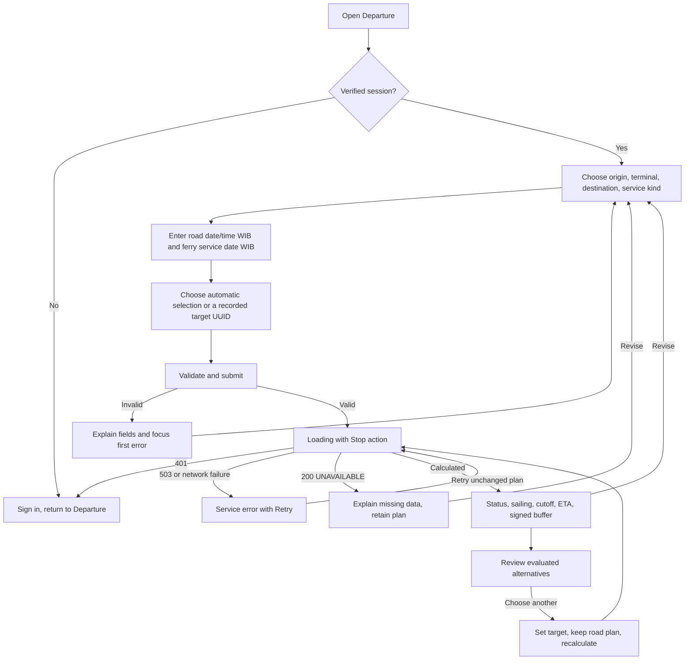

# Departure user flow

23 October 2026. D1-01 design, not an implemented page. Use the existing dashboard shell at `/departure` and existing controls. Follow [the contract](../contracts/DEPARTURE_API_CONTRACT.md), [wireframes](WIREFRAME.md), and [policy](../data/SCHEDULE_POLICY.md).

1. Explain road departure, terminal arrival, and ferry departure as distinct times. Require the operator to choose service applicability; do not preselect cargo permission based on a ferry label. Resolve a supported origin or explicit Batam coordinates. Terminal binds backend catalog coordinates.
2. Destination is required. Service date is a separate labeled sailing date, defaulting visibly to the road date but never changing silently after editing; next day must be chosen explicitly. Derive and show road day type. All visible times include WIB and full dates where days differ.
3. Automatic choice is the default target mode. A recorded target picker preserves UUID, cutoff, terminal, destination, and service date; the existing Planner clock-copy picker is insufficient. Show unknown metadata as “Not verified”; permit requesting an identified row to learn why it is unavailable, without enabling invented dates/cutoffs. No target lookup match gives an explicit absent-target correction, not automatic substitution.
4. Submit only with complete valid request fields. Name conflicting target fields clearly. Backend validates again. In prototype/fixture sessions show a persistent “Synthetic scenario” label; production rows with unknown required metadata produce unavailable results.
5. On result, focus a result heading (`tabindex=-1`) and announce status/reason politely once. Show ferry identity and times first, then ETA, signed buffer, threshold, sources, verification time, and assumptions. SAFE means estimated buffer meets the configured simulation threshold, with no boarding guarantee.
6. Alternatives show only evaluated applicable SAFE/RISKY sailings and their individual buffers. “Choose and recalculate” keeps the road plan and requests that UUID. A missed target stays visible until this explicit action. No alternatives means “No evaluated feasible alternatives on this service date”; distinguish excluded unknown candidates/truncation.
7. Latest departure is labeled “Fixed-duration estimate; recalculate for its traffic period.” “Use this road time” fills both local date and time, clears the prior result, and requires an explicit Calculate action. The next request must still satisfy the service-date horizon; never copy just the clock across midnight.

## State and accessibility contract

| State | Visible behavior / focus |
| --- | --- |
| Initial | Labeled form, clear time meanings, no result or safety claim. Keyboard follows visible order. |
| Reference loading | Announce schedule loading; preserve typed plan. Automatic calculation can still explain missing data; never invent picker options. |
| Validation / 422 | Error summary plus linked inline messages; focus first invalid field. Retain values. Unknown terminal/service conflicts have a correction path. |
| Request loading | Disable duplicate submit; show “Calculating…” and keyboard-accessible Stop; form remains editable. Announce loading without repeatedly moving focus. |
| Stop | Abort/ignore request; keep form, clear decision, announce stopped. No error recommendation. |
| Empty lookup | UNAVAILABLE / no schedules, selected constraints and service date visible; offer revise, not a guessed next sailing. |
| Missing/stale metadata | UNAVAILABLE with exact missing reason. Show known target and verification status. Decision ETA/buffer remain unavailable; any route-only estimate is labeled separately. |
| SAFE/RISKY/MISSED | Status word, explanatory sentence and signed units; color supplements text. Exact zero is RISKY. Full dates expose overnight effects. |
| Network/503/malformed body | Service-error panel with Retry; no recommendation result. Auth outage and missing schedule data have distinct wording. |
| 401/logout/account change | Clear result, pending responses, and account-scoped state; direct to sign-in. Do not preserve successful cards across identities. |
| Input change/in-flight race | Abort prior request and increment request generation; clear result and alternatives immediately. Ignore completions for older generation/account. Recalculate explicitly. |
| Truncated candidates | Automatic unavailable or selected result with no alternatives and an explicit incomplete-search notice, per policy. Never label the search exhaustive. |

Desktop and mobile use the same DOM reading order. Visible labels are programmatically associated; helper/error descriptions use `aria-describedby`, invalid fields use `aria-invalid`, and status/error announcements use appropriate live regions. No color-only states, hover-only information, automatic submission, or inaccessible custom time controls. Controls have visible focus and usable touch targets (design target 44 px). Browser/keyboard/accessibility verification belongs to D5-06, not this document.

## Ownership and future shared changes

Ananda adds the departure-specific form/result lifecycle and typed client. Khairul's route/maps, Danial's congestion/Oracle, and Chelsea's schedule data remain their services. `backend/main.py`, Sidebar, possible Topbar title mapping, and explicit middleware protection are the conditional shared integration edits from Sprint 0. No frontend code or prototype was built in Sprint 1.
