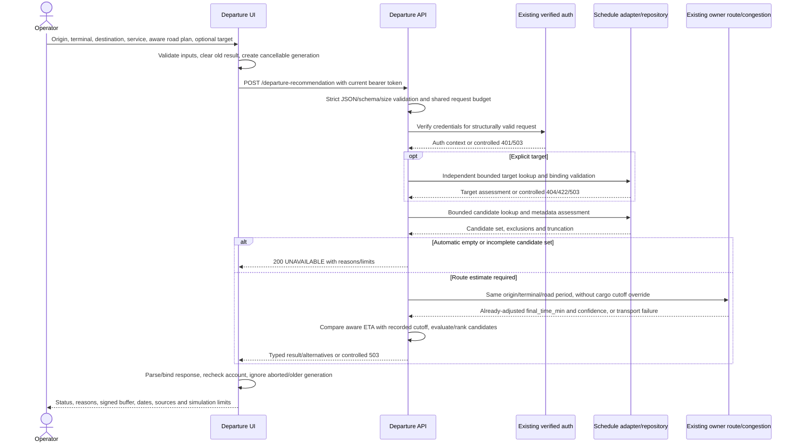

# BAB III / BAB IV evidence map — partial Sprint 6

24 October 2026, Asia/Jakarta. D6-06 preparation, **not completed academic/live/usability acceptance**. Ananda Khusnul Hotimah — 3312401044 owns departure calculation, integration, interface and evaluation. Danial owns congestion/model training, Khairul route/maps, Chelsea schedule data/CRUD. This report does not attribute their services/model accuracy to Ananda.

| Report part | Claim that current evidence supports | Source | Limit / missing evidence |
| --- | --- | --- | --- |
| BAB III — requirements/scope | Defined departure flow and DEP-01–DEP-14 acceptance criteria | [Context](../context/context_improve.md), [sprint plan](../planning/DEPARTURE_IMPLEMENTATION_SPRINTS.md) | Design/ownership evidence, not user-study outcomes |
| BAB III — flow/wireframe | Designed input/result/error/mobile flow | [User flow](../design/USER_FLOW.md), [wireframe](../design/WIREFRAME.md) | Design dated 23 October; actual screenshots are separately captured below |
| BAB III — sequence/integration | Implemented request handling and owner-service boundaries | Sequence below; backend router/dependency/calculation source | Executed with injected fake I/O; signed-in live chain pending D6-02 |
| BAB III — formulas/status | Aware ETA, recorded cutoff buffer and exact threshold policy | [Contract](../contracts/DEPARTURE_API_CONTRACT.md), [policy](../data/SCHEDULE_POLICY.md) | Positive project simulation threshold; no invented SOP or booking guarantee |
| BAB III — data/provenance | Three project terminal mappings and explicit metadata requirements | Schedule policy; shared catalog; contract | Real occurrence/service/freshness/route-context evidence remains open |
| BAB III — API examples | Frozen expected request/response shapes | [Synthetic examples](../contracts/DEPARTURE_API_EXAMPLES.json) | Authored simulation examples, not real endpoint captures |
| BAB IV — functional behavior | Fresh synthetic passes for DEP-01–DEP-13 | [Matrix](../evidence/sprint-6/ACCEPTANCE_MATRIX.md), [actual backend outputs](../evidence/sprint-6/backend-acceptance.json), [browser outputs](../evidence/sprint-6/browser-acceptance.json) | DEP-14 pending genuine participants; no real sailing inference |
| BAB IV — regressions | 431 backend assertions, 26 headless UI groups, 18/8 helpers, typecheck/scoped lint/build pass | [Acceptance report](../sprints/SPRINT_6_ACCEPTANCE.md), Sprint 6 logs/XML | Initial full lint failed 7 errors/19 warnings; after evidenced fixes it passes 0 errors/16 warnings. Follow-up: 5 U4, 5 shared and 13 Planner browser groups passed; earlier 431 backend results were not rerun |
| BAB IV — interface screenshots | Actual headless Next UI at 1440 px and 375 px, inspected | [Synthetic desktop](../evidence/sprint-6/departure-desktop.png), [synthetic mobile](../evidence/sprint-6/departure-mobile-375.png) | Fake Auth/API; not real login/backend or physical-device usability evidence |
| BAB IV — duration measurements | Actual wall time of 63 in-process ASGI requests and 9 injected errors, three synthetic catalog scenarios | [Timing samples](../evidence/sprint-6/synthetic-latency.json) | Mock I/O/model; no network/production latency, model accuracy, dispatch-time or traffic measurement claim |
| BAB IV — usability | Protocol, moderator guide, readiness status and blank observation form prepared | [Protocol](USABILITY_PROTOCOL.md), [moderator guide](USABILITY_SESSION_GUIDE.md), [pending results](USABILITY_RESULTS.md) | 0 sessions recorded; institutional/participant readiness pending; U4 fixture preparation verified synthetically; no approval, scores, observations or benefits invented |
| BAB IV — fixes/limitations | Seven lint errors and one observed schedules hydration error fixed/retested; U4 fixture gap closed synthetically | [Issue register](../evidence/sprint-6/issues.json), acceptance report | D6-05 complete for current observed issues; new actual integration/usability findings can reopen it |
| Contribution/revision evidence | Existing Sprint 6 commits contain the evidence/fixes; nine recorded source hashes match current files on 25 October | [Revision verification](../evidence/sprint-6/revision-traceability.json), [initial source context](../evidence/sprint-6/source-context.json), [follow-up source hashes/results](../evidence/sprint-6/follow-up-verification.json) | Earlier uncommitted captures remain historical. Commit inclusion establishes source lineage, not personal authorship, a fresh whole-tree test run or a released artifact. |

## Revision references verified 25 October 2026

For D6-06, Git inspection now establishes these existing revisions. No commit was created during this review.

| Revision | Verified report relevance |
| --- | --- |
| `eaca538a842aa7451793bfc233d0775f5381054a` | Sprint 6 acceptance outputs, follow-up verification and shared frontend fixes |
| `3dc6c6afea370b497ef9a00f3012a42787c3ce0b` | Frontend Supabase configuration guard |
| `40e1b29f8d7b05058e12fad4dd260d2fb6a926ef` | Operator configuration diagnostic and synthetic configuration-fix evidence |

Read-only `git log`, `git show`, revision/path checks and SHA-256 comparisons verified three commits and all nine explicitly recorded source hashes from `follow-up-verification.json` and `supabase-config-fix.json`. This closes the missing revision-reference portion of D6-06. Existing application test counts remain attributed to their original runs; no application test was rerun. Real integration and participant findings remain absent, so D6-06 stays partial.

The user currently reports inability to sign in, with an earlier “Failed to fetch” message. This is user-reported blocking evidence, not an assistant-reproduced defect or a confirmed configuration diagnosis. Actual authenticated outputs and network durations cannot be added until that blocker is resolved and the manual checks run.

## Implemented sequence (offline boundary exercised)



The diagram describes implemented boundaries, not a captured live sequence. Structural validation may return 422 before auth; auth precedes schedule/route reads. Selected mode never silently substitutes a different target. One validated route estimate is reused for matching candidates. Empty automatic lookups/overflow can skip routing. HTTP outages are not successful UNAVAILABLE calculations.

## Calculation table for BAB III

```text
ETA = aware road departure + validated route final_time_min
buffer_min = (recorded cutoff - ETA).total_seconds() / 60
latest_departure_estimate = recorded cutoff - travel duration - configured safety buffer
```

| Required data / unrounded buffer | Backend status |
| --- | --- |
| Required occurrence or confidence data missing | UNAVAILABLE |
| buffer < 0 | MISSED |
| 0 <= buffer < positive configured threshold | RISKY |
| buffer >= threshold | SAFE |

Congestion is already included in `final_time_min`; it is not multiplied again. Known source zones are converted to Asia/Jakarta with full dates. Zero and negative values are meaningful; display rounding does not choose status. The latest-departure value reuses the submitted traffic-period duration and requires recalculation if adopted; it is not global traffic optimization.

Do not conclude reduced missed departures/emissions, observed traffic accuracy, real schedule reliability, improved usability, production latency or a population success rate from this evidence. Real integration and actual participant findings must be added separately with their actual limitations and denominators. D6-06 remains partial until those results exist or the final report explicitly records their incomplete status under the agreed academic scope.
