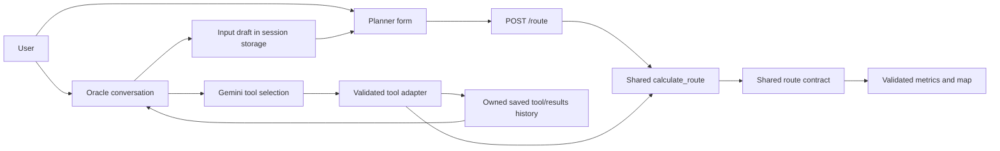
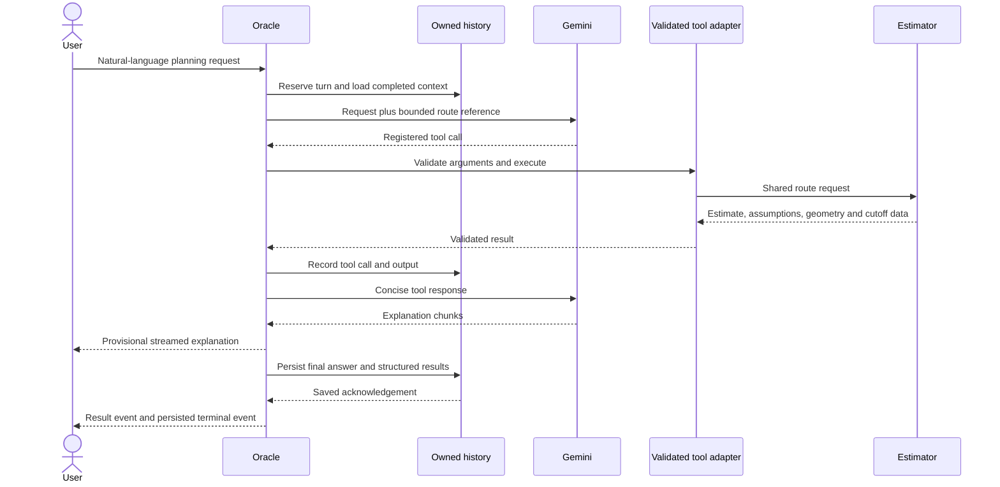

# Planner–Oracle integration evaluation guide

17 October 2026. This is a procedure and evidence guide, not a completed user study or an agent-accuracy claim.

**Implementation scope**

The Planner and Oracle share the existing route estimator. Oracle resolves supported names and validates tool arguments; the Planner submits validated coordinates through `/route`. Both consume a shared response contract and display the same route-detail component. A saved Oracle estimate can supply a bounded, account-scoped input draft to the Planner without executing a new calculation or changing chat history.





**Reproduce the automated checks**

From the repository root, run the backend tests with `backend/.venv/Scripts/python.exe -m pytest backend/tests -q`. Database lifecycle/RLS tests require `ORACLE_TEST_DATABASE_URL` pointing to an authorized, disposable loopback PostgreSQL admin database. Their fixtures create/drop uniquely named test databases and reject non-loopback hosts. Do not point them at production or run `backend/database/schema.sql`.

From `frontend/`, run:

```powershell
npx tsc --noEmit
node scripts/check-oracle-results.mjs
node scripts/check-oracle-stream.mjs
node scripts/check-oracle-history.mjs
node scripts/check-oracle-markdown.mjs
node scripts/check-route-integration.mjs
npm run build
```

Browser scenarios live in `frontend/scripts/check-route-integration-ui.js` and the existing Oracle browser-check scripts. They run through `playwright-cli run-code --filename` against the loopback Auth/API fixture on 9010 and an isolated Next process on 3010. The Next process must use fixture-only public Auth/API environment values. Use the fixture-generated synthetic account state, never production tokens. Production FastAPI continues to use port 8080 when started separately.

The browser fixture is a UI transport test, not the real route estimator. Its displayed 15-minute estimate is synthetic. Backend parity fixtures use 10 base minutes × 1.5 = 15 minutes; live-agent evaluation fixtures use 10 × 1.2 = 12 minutes. Keep these environments and denominators separate.

**Agent evaluation sets**

| File under `backend/tests/fixtures/` | Purpose |
| --- | --- |
| `oracle_integration_development.json` | Six development requests; excluded from final scores |
| `oracle_integration_pilot.json` | Three already-used pilot scenarios; excluded from the final set |
| `oracle_integration_cases.json` | Sixty final technical scenarios, ten per category; domain review and full execution pending |

The final set was frozen after implementation. Cases used during the live pilot were replaced before freezing; the original source catalog and its hash remain with the pilot evidence. These are authored project scenarios, not a published independent benchmark. Review expected behavior with a domain reviewer before an academic quality claim. If expected labels or prompts change, increment the version and record a new dataset hash.

Default evaluation mode validates the selected dataset without provider calls:

```powershell
& backend/.venv/Scripts/python.exe backend/scripts/evaluate_oracle_integration.py --output output/playwright/evaluation-manifest.json
```

An explicitly requested live pilot consumes Gemini quota, while all route/congestion/schedule dependencies and persistence remain controlled:

```powershell
& backend/.venv/Scripts/python.exe backend/scripts/evaluate_oracle_integration.py --cases backend/tests/fixtures/oracle_integration_pilot.json --live --variant enhanced --limit 3 --max-provider-requests 8 --output output/playwright/enhanced-pilot.json
```

Use `--variant baseline` for the original `c214987` system prompt with explicit route reference disabled. Both variants use the same current tool implementations and deterministic fixtures. This isolates prompt/context orchestration; it does not reconstruct the entire earlier deployed application. Record execution order because service load, connection setup, and caching can affect timings.

For the final set, use the default cases file and bounded `--ids`, `--limit`, `--repetitions`, and `--max-provider-requests` batches. Up to three repetitions are supported. Do not replace a failed or unrun case with an invented success. The runner stops a live batch after an actual quota error and records unfinished runs; controlled provider-failure cases are labeled separately.

**Scoring and review**

The runner records tool selection, normalized argument agreement, provider/tool outcomes, first server-status/text-event timings, completion time, request counts, available SDK token usage, model, source file hashes, and dataset hash. Server-status timing excludes the frontend's immediate local pending indicator. Location aliases are compared by resolved coordinates. Inherited ISO-derived dates are normalized without discarding their calendar meaning. Failed provider turns are ineligible for automatic tool/argument grading.

Do not treat schema-valid arguments or a `completed` terminal event as semantic task success. Review every measured conversation against the user intent and returned data:

1. Did the agent select the appropriate tool, or appropriately avoid tools?
2. Did it preserve explicit places, times, dates, cargo and ETD meaning?
3. Were missing or ambiguous details clarified without unnecessary questions?
4. Did the explanation agree with the actual tool values and uncertainty?
5. Did it distinguish a matched origin-area congestion corridor from the route's actual road sequence?
6. Did the user obtain the requested planning outcome or a useful correction/failure explanation?

Create a JSON array of actual reviewer verdicts, using keys copied from the run:

```json
[
  {
    "id": "complete-01",
    "variant": "enhanced",
    "repetition": 1,
    "human_task_success": true,
    "human_grounding_pass": false,
    "notes": "Illustrative format only; replace with actual reviewer findings."
  }
]
```

The example is a format illustration, not a judgment on a recorded conversation. Apply a real review without new provider requests:

```powershell
& backend/.venv/Scripts/python.exe backend/scripts/evaluate_oracle_integration.py --review-report output/playwright/enhanced-pilot.json --reviews output/playwright/reviewer-verdicts.json --output output/playwright/reviewed-pilot.json
```

Unknown/duplicate run keys and non-boolean verdicts are rejected. Keep human review pending until a person has reviewed it; implementation-agent analysis is technical review and must not be mislabeled as a human participant or expert evaluation.

Report both scenarios and attempts, successful/failed/unrun counts, task-success denominators, repeated-run consistency, and explanation-grounding failures. Median/p95 values with very small samples are descriptive only. Report semantic quality separately from quota, network and controlled failure tests. Raw token counts are available; no monetary cost is inferred without a verified pricing source.

**Usability protocol**

Use equivalent tasks through Planner and Oracle: a route-only estimate, a date-aware vessel-cutoff check, and a follow-up correction followed by editable handoff. Counterbalance interface order across representative users. Record the actual participant group/count and whether participants are logistics operators, students, or another subgroup.

For each task record anonymous participant ID, interface order, completion, elapsed seconds, corrections, and whether the participant correctly explains the map, cutoff slack, and estimate limitations. Keep the routing data fixed across interfaces. Summarize actual counts and observations; an unavailable participant sample remains pending. Browser automation is not participant usability evidence.

**Report placement and claim boundaries**

BAB III 3.3 describes the estimator and external-model tool orchestration; 3.4 uses the contracts, diagrams and handoff design; 3.5 defines this evaluation. BAB IV 4.4 shows implemented screens and API/tool traces, and 4.5 presents only collected results.

The implementation estimates one route with an origin-area congestion proxy. Suggested departure is back-calculated using congestion at the requested time. It is not global route optimization, verified real-time traffic, verified vessel capacity, a booking, or measured emission savings. The existing synthetic Random Forest score is separate from agent quality and real-traffic validation.
